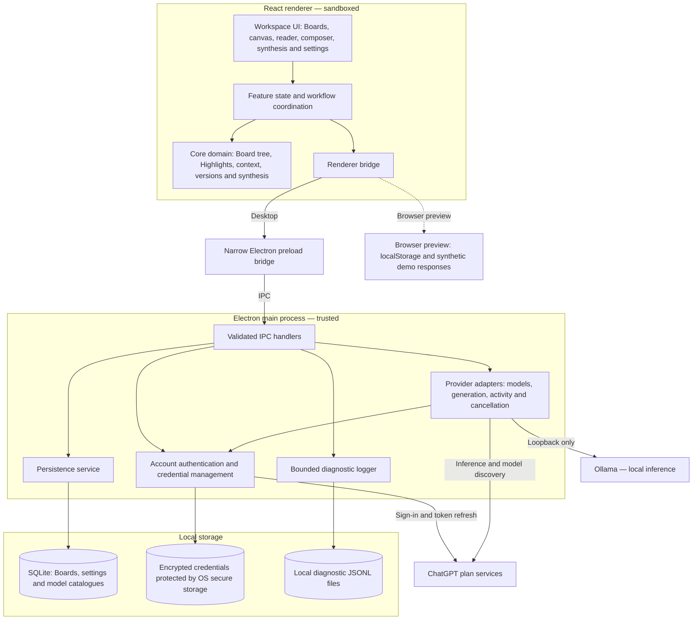

# Architecture

Noteboard separates a React renderer from an Electron main process. The sandboxed preload exposes only Board/settings persistence, model discovery, generation, cancellation, stream subscription and opening the fixed diagnostic logs folder. The renderer has no Node access and cannot call arbitrary remote inference endpoints. External navigation and new windows are blocked; narrow main-process actions open the generated OpenAI authorisation URL, fixed ChatGPT usage settings and user-clicked validated HTTP/HTTPS source links in the system browser; rendered Markdown does not execute HTML or fetch images.

## High-level architecture

Arrows show calls and dependencies; results and stream events return through the same bridge. The renderer owns interaction and domain workflows. Privileged storage, credentials and provider networking sit behind the Electron boundary. Browser preview uses a separate local demo implementation.

The UI and coordination live in `src/App.tsx` and `src/features/`; shared domain rules live in `src/core/`. `src/bridge.ts` selects the desktop bridge or browser preview. `electron/preload.ts` exposes the narrow IPC API, while `electron/main.ts` validates requests and coordinates persistence, providers and authentication. See [renderer feature ownership](#renderer-feature-ownership) for the detailed state and component map.

`electron/diagnostics.ts` owns local structured JSONL diagnostics. One main-process instance records app lifecycle/version/platform, renderer exits/unresponsiveness, trusted IPC outcomes and timing, and generation outcomes correlated by request UUID. Runtime allowlists discard arbitrary fields. Error classification retains only fixed categories and recognised network cause codes; raw messages, stacks, URLs, account identities, Board/Note content, custom instructions, attachments and credentials are excluded. Files rotate at 1 MiB with two backups, stay outside Board storage/exports, and are never sent anywhere. Writes are synchronous and bounded; failures warn once without breaking application operations. A sender-validated `diagnostics:open` action opens only the fixed app logs directory through the native shell; the renderer cannot read files, select a path or submit log payloads. The desktop workspace menu exposes this action through App; browser preview has no diagnostic-files capability.

## Domain records

A `Board` has a schema version, title, timestamps, spatial Notes, directed Edges, document artefacts and a viewport. Zod validates saved/imported records. Additional graph validation rejects cycles, multiple roots, duplicate identifiers, missing sources and invalid Highlight ranges.

Each `Note` preserves its original prompt, position, optional editable title, editable Takeaway and immutable response versions. Revised prompts belong to their new response version; older versions fall back to the Note's original prompt. Titles are display metadata; untitled canvas Notes show the latest version's prompt. The reader selects a version and shows its prompt, response, metadata and effective request. Generated versions record text, provider, model, timestamp, effective context, token estimate and available usage. Human-edited versions are explicitly labelled, retain `basedOnVersionId`, and have no inference context or usage. Imported versions preserve visible text and source message identities, available dates and model metadata; original context, estimates and usage remain unknown. An `Edge` is either a Highlight branch with one exact source anchor, or an imported continuation with chronological message references and an optional retrospectively confirmed Highlight. A passage may motivate several independent branches.

Edit prompt and regenerate, Regenerate response and Edit response append versions without overwriting earlier records or changing Edges. Revisions identify their base version and pin every ancestor through `ancestryVersions`; new generated child versions also pin their complete ancestry. Legacy Highlight branches resolve parents through their saved anchor version, while imported continuations resolve original imported turns independently of retrospective annotations. Retrospective Highlights must reference the original imported response, never a later revision. Regeneration uses the viewed version's ancestry and the currently configured provider/preferences, with an optional model override; changing that model clears the thinking-effort override for the request. The recorded final user message retains its exact Highlight framing with only the known prompt suffix replaced; human edits follow their base-version chain to that record. It excludes the Note's old answer, descendants and siblings. Imported regeneration is a new request from visible preserved messages, not a reconstruction of unknown historical inference. Cancellation/failure keeps the draft and adds no version. Manual edits make no provider request, preserve Markdown/LaTeX and retain their source revision. New branches use the viewed response; the canvas and new synthesis use latest versions. Following an Edge or existing synthesis source opens its exact source version.

Selections in formatted Markdown use DOM Range offsets into the complete rendered text snapshot. This avoids guessing Markdown offsets or choosing the first repeated substring. Text surfaces are version-specific. Example Notes use Markdown-surface anchors; the reader locates their passage in the rendered surface when possible and always shows the complete source Highlight separately.

**Sanity check & improve** appends a generated version of the same Note. Its request includes the viewed response as an assistant turn followed by the editable review prompt. For generated responses, the preceding recorded conversation is preserved, including earlier review turns and exact Highlight framing; the system guidance uses current response preferences. Human edits retain the request of their generated base but supply the viewed edited text as the answer to review. Imported originals use their preserved visible ancestral conversation without inventing historical generation context. The new version retains the original question for the viewed version, its ancestry pins and `basedOnVersionId`, and records the complete effective review request. Existing Highlights, descendants and synthesis references keep their original versions. Normal context-budget, cancellation and failure handling applies; demo reviews remain synthetic.

Notes and synthesis share GitHub-flavoured Markdown and local KaTeX rendering. Maths supports `$…$`, `$$…$$`, `\(…\)` and `\[…\]`; alternative delimiters are normalised for display outside code, leaving stored source text unchanged. KaTeX CSS/fonts are bundled locally; trusted TeX commands are disabled. Invalid equations remain visible as source text. A Highlight intersecting a typeset equation expands to the whole equation and records its exact LaTeX in `latexSources`, which is included in the follow-up request. Its `displayText` uses LaTeX for readable labels and learning journeys while its original text and offsets retain the complete rendered snapshot. New anchors identify the maths-enabled rendered surface with `renderedMath`; reopening an older rendered anchor uses the original non-maths renderer to retain its saved offsets and snapshot. No saved anchor is migrated.

## Conversation import

The local ChatGPT export importer validates conversation mapping graphs, previews one selected path, and saves a complete new Board before opening it. It uses browser File APIs and the existing persistence bridge. Only complete alternating text turns are accepted; excluded system/developer records are reported, while unsupported content and invalid paths are rejected. Imported continuations retain chronology even when a user adds, replaces or removes a retrospective Highlight. Normal branches traverse imported ancestry unchanged; historical generation requests are not reconstructed. See [import documentation](chatgpt-import.md) for limits and compatibility.

## Context and providers

`buildContext` reconstructs root-to-parent ancestry, then appends the selected passage and new user prompt. Sibling Notes are excluded. The request is recorded on the resulting response version. A conservative UTF-8 byte estimate and 1,024-token output reserve provide a preflight budget check, not exact tokenisation. There is no automatic context reduction.

New Boards start with the **Explore** response profile: answer immediately with the shortest complete answer and only essential concepts and qualifications. Further development, related concepts and examples require an explicit request. Uncertainty appears only where it affects the answer; no recap, concluding Takeaway, suggested questions or further-exploration section is added. The human develops the inquiry through Highlights; Consolidate handles recaps and synthesis. These scope rules override the shared baseline's broader analysis/heading suggestions. **Direct answer** prioritises practical resolution; **Critically evaluate** examines evidence, alternatives and verification. All three share Australian English, accuracy, honest uncertainty and source-integrity guidance. They do not manufacture curiosity hooks or create branches. The canvas uses an explicit Takeaway if present or the first substantive paragraph as a lightweight, editable fallback; no extra inference request is made. Follow-up orientation uses only the supplied ancestral path and selected Highlight. Existing and imported responses are not rewritten, and demo responses remain scripted and synthetic.

`src/core/response-profiles.ts` owns validated profile identifiers and deterministic instruction resolution. Optional Board `responseProfile` metadata is additive within schema version 4 and survives save/export/import without new tables or IPC. Absence means **Custom**, preserving existing Boards' preferences. The workspace selector changes the default for future requests; the composer and generated revision dialogues offer request-local overrides. Composer Customise exposes the effective preference text; editing switches that request to Custom without rewriting saved settings. Standard profiles replace, rather than append, legacy custom preferences. The existing context builder combines resolved instructions with task/environment guidance before budgeting and provider conversion; immutable generation contexts remain the authoritative record of the exact instructions used. Profile defaults never alter ancestry, source versions or Highlights. Generated synthesis continues using saved custom instructions; verbatim journeys use no inference.

Editable `customInstructions` live in validated local settings (maximum 12,000 characters). Older settings receive response-style, accuracy, source and recommendation defaults; an explicitly empty value means basic Noteboard guidance only. Provider settings use a draft with Save, Cancel and Restore response preferences. Instructions apply across providers to Notes using Custom and to generated synthesis, not verbatim learning journeys. The exact custom text is combined with task and environment guidance in the first system message (converted to developer for ChatGPT), included in the context budget and preserved in each generation record. Settings themselves are not exported, but instructions recorded in generation context are. Environment guidance accurately states whether web search is enabled and that execution tools are unavailable and Noteboard is outside ChatGPT projects; Board titles do not establish ChatGPT project membership. The default preferences contain no personal JCU boundary.

The `Provider` interface declares streaming, model discovery and authentication capabilities. Demo generation is explicitly synthetic. The Ollama adapter runs in the main process and accepts only loopback endpoints. It discovers `/api/tags`, checks model context capability with `/api/show`, and streams `/api/chat` as newline-delimited JSON. Complete records are committed only after the stream's completion marker. Aborting or failing leaves the source Board untouched.

ChatGPT fetch and stream-read failures are translated by the main-process `chatgpt-transport` helper into connection, cancellation or timeout messages. HTTP rejections and malformed response events keep their own errors. A validated `response.completed` record ends reading without waiting for connection closure; partial output still cannot commit. Requests are never automatically replayed. The renderer removes Electron's invocation wrapper from displayed errors and retains the draft and request choices for a human-initiated retry.

The ChatGPT adapter uses the documented local-app Sign in with ChatGPT public-client flow. A loopback callback validates state, exchanges a PKCE-bound code, verifies the ID-token signature/issuer/audience/expiry/nonce, and keeps issued client IDs bound to verified subjects. Separate saved registrations support different accounts/workspaces. A stable host UUID is reused. Credentials reside in an atomic, OS-encrypted file with owner-only permissions, independent of Board/settings persistence; the preload exposes only account labels, connection state, sign-in/cancel/sign-out and a fixed usage-settings action. No token reaches the renderer. Expiring tokens refresh through a serialised rotation; terminal refresh errors clear tokens while retaining registration. Sign-out attempts remote revocation and reports if only local sign-out succeeded.

ChatGPT model discovery uses the selected account’s token. Selecting ChatGPT with a connected, plan-enabled account automatically loads its catalogue. Settings, new Note composers and revisions share an account-scoped in-memory cache; the main process persists validated catalogues in a separate SQLite `model_catalogues` table. Each catalogue records discovery time, model IDs/names in server order, and any reported thinking levels, descriptions and default. Reopening reuses the saved catalogue; Refresh models explicitly reloads it and replaces it only on success. Sign-in and sign-out invalidate both caches for that account. Pending requests are deduplicated, and late results cannot restore an invalidated catalogue or replace another account’s choices. Catalogues contain no tokens or instructions and are excluded from Boards and exports. Discovery failures remain visible and can be retried with Refresh models. Inference sends complete role/content pairs to Responses with `store: false` and `stream: true`. System messages are converted to developer messages before recording and transmission, preserving exact effective context. No provider conversation state, automatic truncation or API-key fallback is used; explicitly enabled web search is the only hosted tool. Failed/incomplete/interrupted streams cannot commit a Note or artefact. The local estimate reserves output space but the preview route has no supported output cap; service errors remain authoritative.

The ChatGPT model picker retains account-catalogue ordering and display names while submitting model slugs. Switching provider, account or model clears the thinking-effort override. Settings, Note composers and generated revisions use the selected model’s advertised thinking levels and descriptions in catalogue order. Missing metadata remains unknown; an explicit empty list means no advertised overrides. Model default is always available and omits the parameter, even when the catalogue reports a default. An existing override absent from a refreshed catalogue remains visible as unconfirmed until the human changes it; it is never silently replaced. Future unrecognised levels are retained in the catalogue but disabled in the picker until the app supports them. Optional validated `reasoningEffort` settings map to Responses `reasoning.effort`. Service rejection is reported without retrying at another effort. Completed generated Note and document versions preserve the explicitly requested effort; older and imported records retain unknown effort rather than receiving an inferred default.

New Note composers initialise request-local model and thinking-effort choices from saved settings, including for Highlight branches. Model discovery uses the existing provider bridge. Changing the composer model clears its effort override; generating uses the selected request settings for budgeting and inference. No composer override writes saved settings or changes previous Notes, and each newly opened composer starts from the saved defaults. Failed or cancelled generation retains the draft choices for retry.

Credential loading is lazy and cached in the main process. Listing accounts without an existing credential file does not access secure storage or create a file. Once unlocked, account listings and valid-token reads reuse the in-memory vault without repeating availability checks or rewriting credentials. Reopening an existing vault only decrypts it; new registrations and token changes still use encrypted atomic writes. Unavailable storage checks can be retried.

On macOS a main-process-only Node-API module stores a random 256-bit vault key in the data protection Keychain, using `kSecAccessControlUserPresence` and `kSecAttrAccessibleWhenUnlockedThisDeviceOnly`. Reading it invokes the system's Touch ID/password authentication; no separate cosmetic biometric prompt is used. A Keychain read is required even immediately after creating a key. The key stays in main-process memory for the session and is cleared on disposal. Credentials use a versioned AES-256-GCM envelope, fresh nonces, and authenticated data tied to the vault path; they never reach the renderer. The Keychain item is local to this Mac, scoped to the signed app's access group and a hash of the credential path. Decryption of an existing envelope never creates a missing key or falls back to legacy decryption. The app requires profile-authorised application and Keychain entitlements; unsigned development hosts cannot open it. Other platforms retain Electron `safeStorage` and reject insecure backends.

Legacy macOS `safeStorage` files are decrypted once, schema-validated, then atomically replaced only after the protected key is created and successfully read. This can require the old login-Keychain password once. Cancellation, invalid source data or a failed write retains the existing file and clears provisional in-memory data, allowing retry. Original host/account registrations and tokens are preserved; the old Keychain item is not deleted. There is no automatic fallback to unprotected storage. Packaging requires a valid macOS provisioning profile authorising the app identifier, Keychain group and selected signing certificate; only the main executable receives credential entitlements.

## Persistence

Board schema version 4 adds file-bearing user messages, immutable per-version file inputs and optional web-search provenance. Older versions 1–3 migrate without adding inferred file, search or citation history. New exports require a version-4-aware app so older clients cannot silently remove attachments. SQLite tables are unchanged.

ChatGPT Note generation and revisions enable the hosted `web_search` tool by default, with per-request controls and an optional saved default. The completed Responses output supplies search-call actions and URL citation ranges, retained separately from the immutable response text. The reader substitutes clickable citation labels only for display and records rendered Highlight snapshots as before. Source URLs are restricted to HTTP/HTTPS without credentials and open via a validated main-process IPC action, never renderer network requests. Explicitly disabling search omits the tool. Rejections never retry with different tools, files or providers. Synthesis remains limited to the selected Note material and does not enable fresh search.

User-selected PDF, DOCX, PPTX, XLSX, TXT, Markdown, CSV, TSV, JSON, HTML and XML files are read through browser File APIs and sent inline as Responses `input_file` parts; no Files API upload or arbitrary filesystem access is added. File names, decoded byte counts, MIME/data-URI prefixes, base64 and limits are validated at IPC and persistence boundaries. Messages retain text plus optional exact file bytes; the adapter deterministically expands these into `input_text` and `input_file` wire content parts. Version records retain the Note's cumulative own files, and complete effective context retains all files actually sent. Ancestral Notes supply their pinned files; revisions retain existing inputs and self-reviews preserve earlier file-bearing turns. Imported unknown context remains unknown. Non-ChatGPT requests with files fail explicitly instead of discarding them. Limits are 5 MB per file and five files/10 MB over the complete request, including history. Budget estimates add file bytes and a processing allowance; document/page tokenisation remains model-dependent and service limits remain authoritative. Attached bytes are included in Board saves and exports, not stored in provider settings.

Electron stores `inquiry.sqlite` in `app.getPath('userData')`. SQLite uses WAL and three tables: `boards` (validated JSON snapshots with sortable title/update metadata), separate `settings`, and account-scoped `model_catalogues`. The catalogue table is created additively for existing databases; Board/settings tables and user_version remain unchanged. Board JSON schema version 4 retains revised prompts, human-edited responses and pinned ancestry, and adds file/search provenance. Validated version 1–3 records migrate deterministically in memory without changing original prompts, response versions, identifiers or anchors; subsequent writes and exports use version 4. Older app versions reject version 4 exports rather than silently dropping revision provenance. Individual saves are atomic SQLite upserts; the renderer queues snapshots to preserve write order. This favours a straightforward prototype over a prematurely normalised graph schema.

Appearance preferences (Note style, theme, accent colour, reading text size, independent interface/reading fonts and canvas grid) share the validated settings record, with defaults for older records. The renderer applies semantic CSS tokens and listens to system colour-scheme changes when requested. Note style also controls card information hierarchy, width, local Takeaway disclosure (Blueprint) and a collapsible tools section in the Sticky notes/Studio readers. Disclosure state is transient UI state. It does not change Note positions, response rendering, stored versions or selection surfaces; React Flow measures card size changes and updates connector endpoints. Cards also explicitly refresh connector bounds after mounting, changing style or zoom detail, and adding or removing child connections, so new Edges do not rely solely on resize notifications. The expanded Note reader overlays the workspace body while retaining the mounted canvas and its viewport.

JSON export includes exploration and artefacts, not provider or appearance settings. Import validates the tree and anchors and gives the imported Board a new ID. Browser preview uses localStorage and demo inference only, explicitly identified in the interface.

Human-confirmed Note deletion removes the selected subtree and its incident Edges without reparenting surviving Notes. Artefacts retain deleted source Notes in optional `archivedSources` snapshots, including all response versions; validation resolves each source against active Notes or its artefact's archived sources. Source links to deleted Notes open a read-only source view at the recorded prompt/response version. Archived Notes cannot create branches or enter new synthesis/context. Deleting a root leaves an empty Board with its existing artefacts.

Human-confirmed Board deletion removes its SQLite row through a validated narrow IPC action (or its localStorage snapshot in preview). Deletion is serialised with pending saves; queued snapshots skip deleted Board IDs to prevent resurrection. Sidebar context-menu actions target a Board by ID independently of the open Board: renaming updates only that Board's title and update timestamp through the existing save queue, and deleting an inactive Board preserves the open Board and its drafts. The renderer changes Boards only after deletion of the open Board succeeds and retains the target Board for retry on failure. Deleting the last Board opens a fresh empty Board, preventing the synthetic example from reappearing on restart. Provider settings and credentials remain independent.

## Synthesis

A learning journey is deterministic and preserves selected prompt/response versions, explicitly identifying human-edited responses. Integrated explanations and structured artefacts use the configured provider with user-selected source Notes, including human-edit labels. Artefacts store source IDs and response version IDs, generated context and a history of generated/edited Markdown document versions. Source links use `inquiry://note/ID` and reopen the recorded Note version. Revising a Note never rewrites an earlier artefact. The editor supports Markdown plus formatted preview. Returning to Explore or another artefact saves a changed revision in memory and queues local persistence.

## Boundaries

SQLite/network operations remain in Electron; graph, ancestry and selection behaviour are independently testable. No autonomous branching, agent orchestration, shared Boards, paid fallbacks or credentials in Board data are present. ChatGPT protocol: [registration](https://developers.openai.com/siwc/token-sharing-open-source/sign-in), [inference](https://developers.openai.com/siwc/token-sharing-open-source/models-and-inference), [preview limitations](https://developers.openai.com/siwc/token-sharing-open-source/preview-limitations). Provider protocol documentation: [Ollama chat](https://docs.ollama.com/api/chat), [model listing](https://docs.ollama.com/api/tags). Desktop isolation follows [Electron context isolation](https://www.electronjs.org/docs/latest/tutorial/context-isolation).

## Renderer feature ownership

`App.tsx` composes the feature owners and connects cross-feature actions. The sidebar, toolbar and mode/status navigation live in `features/workspace/`. Simple workspace state (mode, selected Notes, sidebar visibility and the shared error message) remains in App. There is no application-wide context or replacement controller hook.

| Feature            | State and operations                                                                                                                                                                                                                                                                                     | Presentation                                                                                                                                          |
| ------------------ | -------------------------------------------------------------------------------------------------------------------------------------------------------------------------------------------------------------------------------------------------------------------------------------------------------- | ----------------------------------------------------------------------------------------------------------------------------------------------------- |
| Boards             | `useBoardStore` owns loading, the Board collection/active identity, saved settings, save queue and deleted-Board protection. `useBoardActions` owns menu/rename/deletion targets and confirmation. `useBoardFiles` coordinates JSON import/export and saving a conversation import before opening it.    | Board menus, import preview, rename/delete dialogues                                                                                                  |
| Composer           | `useNoteComposer` owns the prompt, attachments, request-local profile/custom-instruction/model/effort/search choices and discovery session. It prepares context, awaits the shared generator, builds completed records, updates the Board, then asks the reader to navigate.                             | `NoteComposer`                                                                                                                                        |
| Reader             | `useReader` owns the open Note/version, anchor, selection, revision target, expansion, focused reading and imported-follow-up choice. `useReaderHighlight` restores/clears selections on the same rendered surface. `useSourceNavigation` follows exact saved or archived source versions.               | `ReaderPanel`, `ResponseSurface`, version/connection tools, Highlight actions, generation record and revision dialogue; `NoteReader` retains resizing |
| Canvas             | `useBoardCanvas` owns session Note modes, React Flow dimensions, adaptive Edge handles and viewport restoration. `useCanvasLayout` owns normal-detail measurements, child placement, transient movement/tidy previews and session layout history per Board. Pure geometry lives in `src/core/layout.ts`. | `BoardCanvas`, `NoteCard`, `NoteLayoutMenu`, `HighlightEdge`                                                                                          |
| Synthesis          | `useSynthesis` owns source/output options, consolidation dialogue, active document, edit mode and retained draft/history. It preserves a dirty draft before navigation or export.                                                                                                                        | Synthesis dialogue and workspace                                                                                                                      |
| Settings           | `useProviderSettings` owns its editable draft, discovery and account-busy state; `useAppearance` owns live preview, saving and system-theme subscription. Saved settings still belong to the persistence owner.                                                                                          | Provider, account and appearance settings                                                                                                             |
| Generation         | One `useGeneration` instance owns request identity, busy state, cancellation, provisional text and reported activity for composing, revisions and synthesis.                                                                                                                                             | `GenerationView` presents new-Note activity and provisional text; other callers retain their progress/cancel controls                                 |
| Shared interaction | `useDialogFocus` owns the existing focus trap, Escape listener and focus restoration.                                                                                                                                                                                                                    | Each feature retains its own markup and close-button rules                                                                                            |

Dependencies point from composition to features, and from features to shared components, the bridge and core. Core does not import React, renderer features or Electron. Feature components use explicit typed inputs and callbacks; scoped feature APIs can be passed within their feature. `core/note-operations.ts` holds completed Note record construction and immutable insertion; `core/document-operations.ts` appends an edited document version, shared by saving and exporting a dirty document. The provider abstraction, model-catalogue cache and narrow preload bridge remain the foundations.

### Request and dialogue transitions

A request moves from idle through preflight validation/budget checking to running, then either returns a completed result or rejects. Cancelling marks the single active request and asks the bridge to cancel; even a late completed bridge result is rejected by that owner. Callers append records only after success. Failure and cancellation retain composer/revision/document drafts and request choices. This refactor retains these states and does not introduce independent per-feature generation controllers.

The shared `useGeneration` owner also subscribes to request-scoped text deltas and validated activity events, removes subscriptions on settlement and ignores other request identities and events after cancellation. Providers may report working, thinking or searching; answer deltas indicate writing. The ChatGPT adapter maps reported reasoning-item/summary and web-search events to activity labels without exposing reasoning text. Ollama reports thinking only when a non-empty thinking chunk arrives. Missing provider detail remains Sending request/Working rather than an invented sequence. The preload exposes a narrow `provider:progress` subscription; credentials, request context and Board records are unchanged.

Submitting a new Note replaces the composer with `GenerationView`: the question, current activity, elapsed time, Stop and a provisional streamed response. Synthetic demo activity stays explicitly labelled. Partial output cannot create Highlights or saved Notes. Failure or cancellation restores the existing draft and request choices. Success opens the Note in focused reading, owned by `useReader`, hiding workspace chrome while retaining the mounted canvas. Versions/editing are collapsed; Back to Board restores the existing sidebar preference and normal reader. Response surface markup and saved Highlight offsets are unchanged. Focused reading is transient and is reset on Board navigation/reopening.

Dialogue flags remain independent. Opening a composer, settings draft, consolidation, appearance preview, import, deletion confirmation, archived source, revision or rename does not imply that every other flag is false. The reader can remain open underneath a dialogue; the Board context menu is a separate menu. App supplies all open and busy flags to the focus hook in a fixed order. As before, it focuses the first `.modal`, refocuses when a supplied open/busy flag changes, traps Tab and restores the prior focus on cleanup. Escape dismisses the open dialogue flags together only when generation, account work, appearance saving, import saving and deletion are all idle. Individual close buttons keep their existing busy rules. These policies stay explicit in the composition rather than introducing an unproven mutually exclusive dialogue reducer.

### Persistence and style ordering

Layout preferences are additive optional Note metadata (`childDirection`, default Right) in schema 4; coordinates and preferences use the existing Board save queue. Layout undo/redo applies layout-only patches to current Notes and never restores a whole Board snapshot. Structure changes clear the affected Board's session history. Normal-detail bounds are measured offscreen from the card surface without overview styling; they are transient and never persisted. Newly added children are placed after measurement, while existing Notes retain their saved positions. Tidy is a transient preview until Apply, and makes other workspace controls inert while retaining canvas pan/zoom. This adds renderer presentation state only; inference context, provenance and the Electron boundary are unchanged.

`useBoardStore` serialises Board snapshots and deletion through one queue. A delete target is marked before waiting on earlier saves, so queued snapshots skip it. Deletion waits for earlier writes; failure removes the protection, schedules another snapshot and leaves the confirmation available for retry. Active/inactive/last-Board navigation remains in Board actions, separate from the write queue. Conversation imports await prior writes and their own save before opening.

`styles.css` imports foundations, workspace, canvas, Note palettes/cards, reader/prose, synthesis, dialogues, responsive/service rules, appearance, Note layouts and workspace menus in the original order, followed by focused-reading and graph-layout overrides. Later appearance/layout overrides deliberately remain later in the cascade. Moving a selector into an earlier file requires a separate visual review; the split does not add layers or change specificity.

See [refactor verification](refactor-verification.md) for checkpoints, coverage, file sizes and limitations. The size report excludes dependency/generated output by scanning only authored source, Electron, scripts and tests. The existing ChatGPT integration suite has a bounded exception; credential and authentication implementation remains cohesive and unchanged.
